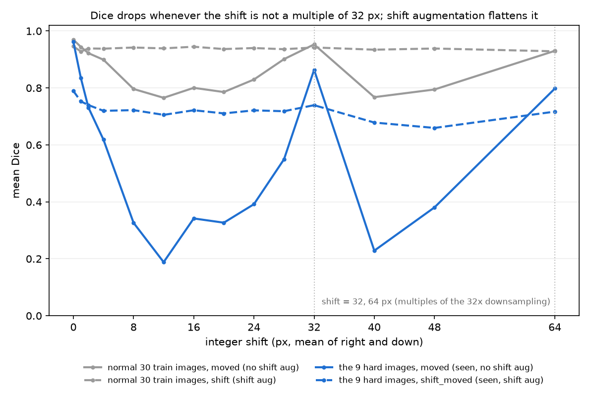

# BUSI：困難樣本與過擬合（討論用實驗）

**結論**
1. U-KAN 在 BUSI 上有過擬合：訓練時加入隨機平移，測試集 Dice 0.782 → 0.818（+0.036，p < 0.001），重訓一次結果相同。
2. 測試集中 Dice 接近 0 的 9 張困難影像，任何資料增強都只到 0.06–0.09：這是「沒見過的類型」，正則化救不回來。
3. 搬進訓練集後這 9 張能到 0.962，但只是死記：平移 12 px 就掉到 0.188。
4. 通用正則化都沒有顯著效果：Dropout 10% / 30%、斑點雜訊相對 base3 分別 +0.002、+0.005、+0.004；Dropout 30% 重訓一次後 0.796 → 0.780，原本的小幅改善沒有重現。
5. Ψ8 加權在平移增強之上沒有額外效果（−0.008，p = 0.29）。
6. 那 9 張大多各自獨立：把其中 6 張搬進訓練集，留下的 3 張多半仍是 0，9 張中只有 2 張（`benign (223)` 0.76、`benign (257)` 0.92）被同類影像帶起來（第 9 節）。
7. 梯度對齊：Ψ8 加權清單的梯度和測試失敗影像的方向相反（17 維 rho_G −0.40、4,721 維 −0.37），隨機一般訓練影像也是負的（−0.18、−0.29），所以加權救不了這些影像（第 8.3 節）。

模型、切分、400 epoch、超參數、評估方式全部與 [U-KAN 官方](https://github.com/CUHK-AIM-Group/U-KAN) 相同，分析一律用最後一個 epoch（last）。
對照組 base2、base3、moved、Ψ 專家的逐張結果在 [psi-weighted-busi/results/percase](https://github.com/OwenWu930302/psi-weighted-busi/tree/main/results/percase)。

## 0. 模型一覽（依類別）

表中的 drop10 / drop30 在訓練資料夾與逐張檔名中是 drop1 / drop3（[aug_BUSI_models.csv](results/analysis/aug_BUSI_models.csv) 的 `train_name` 欄）。

| 類別 | 模型 | 做了什麼 / 回答的問題 | 訓練張數 |
|---|---|---|---|
| 對照組 | `base2` | 原版 U-KAN | 517 |
| 對照組 | `base3` | 原版重訓一次，量雜訊 | 517 |
| 搬移（動機） | `moved` | 9 張搬進訓練集：看過就會嗎？ | 526 |
| 搬移（動機） | `shift_moved` | 9 張搬進訓練集 + 平移增強：還能死記嗎？ | 526 |
| 搬移（動機） | `moved_g1`、`moved_g2`、`moved_g3` | 9 張中 6 張搬進訓練集，留 3 張測試：困難樣本是同一類嗎？（第 9 節） | 523 |
| 資料增強 | `shift` | 隨機平移 ±32 px | 517 |
| 資料增強 | `shift_r2` | shift 重訓一次，確認重現 | 517 |
| 資料增強 | `ssr` | 平移 + 縮放 ±10% + 旋轉 ±15° | 517 |
| 資料增強 | `ssr_int` | ssr + 亮度、對比、gamma | 517 |
| 通用正則化（Dropout、雜訊） | `drop10` | Dropout 10% | 517 |
| 通用正則化（Dropout、雜訊） | `drop30` | Dropout 30% | 517 |
| 通用正則化（Dropout、雜訊） | `drop30_r2` | drop30 重訓一次，確認重現 | 517 |
| 通用正則化（Dropout、雜訊） | `speckle` | 斑點雜訊：每個像素 ×[0.9, 1.1] | 517 |
| 平移增強 + Dropout | `shift_drop10` | 平移增強 + Dropout 10% | 517 |
| 平移增強 + Dropout | `shift_drop30` | 平移增強 + Dropout 30% | 517 |
| Ψ 加權 | `psi8w3n` | Ψ8 加權 ×3（原研究方法） | 517 |
| Ψ 加權 | `psi8w3n_shift` | 平移增強 + Ψ8 加權 | 517 |

## 資料夾

| 路徑 | 內容 |
|---|---|
| [code/](code/) | 對 `train.py` 的修改（patch_*.py）、訓練腳本（run_*.sh）、擾動測試（perturb_busi.py）、分析（make_busi_results.py） |
| [results/percase/](results/percase/) | 本倉庫每個模型的逐張 Dice（best、last），格式同 psi-weighted-busi |
| [results/training_logs/](results/training_logs/) | 每個模型 400 epoch 的訓練紀錄 |
| [results/analysis/](results/analysis/) | 所有彙整表（下面每一節都註明用哪一個） |
| [results/diagnostics/](results/diagnostics/) | failure_diagnostics.py 的結果：每個模型一個資料夾，per_case.csv（每張一列）與 summary.json |
| [results/examples/](results/examples/) | 預測圖（綠 = 標註、紅 = 預測、黃字 = Dice）：perturb/、sweep/ = 那 9 張的擾動與平移；low_other/ = 第 7.1 節的 6 張；benign_116/ = 原圖、標註、base2 輸出 |
| [results/group_lists/](results/group_lists/) | 第 9 節每個分組模型搬進訓練集的 6 張 |

## 1. 我們改了什麼：訓練時即時的資料增強，沒有增加樣本

訓練集 517 張、測試集 130 張都沒變。每次讀取一張訓練影像時隨機變換（影像與遮罩同步），同一張影像每個 epoch 看到的版本都不同；測試時不做任何變換。
唯一動到樣本的是 `moved`、`shift_moved`：把那 9 張測試影像搬進訓練集（訓練 526、測試 121）。

| `train.py` 選項 | 作用 | 程式 |
|---|---|---|
| （官方） | 隨機旋轉 90° + 翻轉 | 原版 |
| `--shift_aug 0.125` | 隨機平移 ±32 px（p = 0.5，邊緣補 0） | [patch_shiftaug.py](code/patch_shiftaug.py) |
| `--scale_aug 0.1 --rotate_aug 15` | 再加縮放 ±10%、旋轉 ±15° | [patch_aug2.py](code/patch_aug2.py) |
| `--intensity_aug 0.2` | 再加亮度、對比 ±20%、gamma 80–120 | [patch_aug2.py](code/patch_aug2.py) |
| `--noise_aug 0.1` | 斑點雜訊：每個像素 ×[0.9, 1.1]（p = 0.5，只改影像） | [patch_noise.py](code/patch_noise.py) |
| `--drop_rate 0.1` / `0.3` | KAN 層 Dropout（原版建立了但 forward 沒有呼叫，接上） | [patch_dropout.py](code/patch_dropout.py) |

不給任何選項時，資料增強與網路輸出和原版逐位元相同（已驗證）。訓練指令 = 官方指令 + 選項：

```
python train.py --arch UKAN --dataset busi --input_w 256 --input_h 256 --name busi_UKAN_shift --data_dir ./inputs --shift_aug 0.125
```

## 2. 每個模型的分數 — [aug_BUSI_models.csv](results/analysis/aug_BUSI_models.csv)

| 類別 | 模型 | 測試集 | 一般 115 | 低分 15 | 那 9 張 | 訓練集 517 | 差距 |
|---|---|---|---|---|---|---|---|
| 對照組 | `base2` | 0.782 | 0.860 | 0.180 | 0.003 | 0.966 | 0.184 |
| 對照組 | `base3` | 0.791 | 0.874 | 0.156 | 0.005 | 0.967 | 0.175 |
| 搬移（動機） | `moved` | 0.837\* | 0.853\* | 0.542\* | 0.962 | 0.968 | 0.130 |
| 搬移（動機） | `shift_moved` | 0.872\* | 0.895\* | 0.442\* | 0.789 | 0.936 | 0.064 |
| 資料增強 | `shift` | **0.818** | 0.895 | 0.233 | 0.089 | 0.939 | 0.120 |
| 資料增強 | `shift_r2` | **0.818** | 0.895 | 0.225 | 0.070 | 0.936 | 0.118 |
| 資料增強 | `ssr` | 0.822 | 0.902 | 0.209 | 0.062 | 0.929 | 0.107 |
| 資料增強 | `ssr_int` | 0.818 | 0.894 | 0.234 | 0.070 | 0.926 | 0.108 |
| 通用正則化（Dropout、雜訊） | `drop10` | 0.793 | 0.870 | 0.207 | 0.000 | 0.965 | 0.172 |
| 通用正則化（Dropout、雜訊） | `drop30` | 0.796 | 0.869 | 0.238 | 0.058 | 0.959 | 0.163 |
| 通用正則化（Dropout、雜訊） | `drop30_r2` | 0.780 | 0.859 | 0.175 | 0.001 | 0.964 | 0.183 |
| 通用正則化（Dropout、雜訊） | `speckle` | 0.795 | 0.865 | 0.255 | 0.114 | 0.964 | 0.169 |
| 平移增強 + Dropout | `shift_drop10` | 0.815 | 0.895 | 0.204 | 0.076 | 0.935 | 0.120 |
| 平移增強 + Dropout | `shift_drop30` | 0.818 | 0.893 | 0.238 | 0.110 | 0.934 | 0.116 |
| Ψ 加權 | `psi8w3n` | 0.804 | 0.882 | 0.203 | 0.016 | 0.959 | 0.155 |
| Ψ 加權 | `psi8w3n_shift` | 0.810 | 0.892 | 0.186 | 0.022 | 0.928 | 0.118 |

測試集 = 130 張；低分 15 = baseline 測試集 Dice < 0.5；那 9 張 = 其中 Dice < 0.2 者；差距 = 訓練集 − 測試集。
\* 搬移模型的測試集只剩 121 張，那 9 張在訓練集（看過），不能直接和其他列比較。

## 3. 成對比較 — [aug_BUSI_summary.csv](results/analysis/aug_BUSI_summary.csv)

測試集逐張配對 Wilcoxon；Δ = 模型 − 對照。搬移比較用 nine（那 9 張）與 remaining（其餘 121 張）。

| 類別 | 比較（comparison） | 對照 → 模型 | 測試集 Δ | p | 那 9 張 Δ |
|---|---|---|---|---|---|
| 對照組 | `noise_noaug` | base2 → base3（不加增強的重訓雜訊） | +0.009 | 0.70 | +0.003 |
| 搬移（動機） | `moved_noaug` | base2 → moved | −0.003（121 張） | 0.69 | +0.960 |
| 搬移（動機） | `moved_shift` | shift → shift_moved | −0.001（121 張） | 0.95 | +0.700 |
| 搬移（動機） | `moved_shift` | moved → shift_moved | +0.035（121 張） | 3.1e-4 | −0.173 |
| 資料增強 | `noise_shift` | shift → shift_r2（加平移的重訓雜訊） | −0.001 | 0.46 | −0.019 |
| 資料增強 | `shift` | base2 → shift | **+0.037** | **1.3e-4** | +0.086 |
| 資料增強 | `shift` | base3 → shift | **+0.027** | **0.0023** | +0.083 |
| 資料增強 | `shift_r2` | base2 → shift_r2 | **+0.036** | **4.5e-5** | +0.067 |
| 資料增強 | `shift_r2` | base3 → shift_r2 | **+0.027** | **0.0016** | +0.064 |
| 資料增強 | `ssr` | shift → ssr | +0.004 | 0.57 | −0.026 |
| 資料增強 | `ssr` | shift_r2 → ssr | +0.004 | 0.80 | −0.007 |
| 資料增強 | `ssr_int` | ssr → ssr_int | −0.004 | 0.68 | +0.008 |
| 通用正則化（Dropout、雜訊） | `drop10` | base2 → drop10 | +0.011 | 0.32 | −0.003 |
| 通用正則化（Dropout、雜訊） | `drop10` | base3 → drop10 | +0.002 | 0.80 | −0.005 |
| 通用正則化（Dropout、雜訊） | `drop30` | base2 → drop30 | +0.015 | 0.14 | +0.055 |
| 通用正則化（Dropout、雜訊） | `drop30` | base3 → drop30 | +0.005 | 0.39 | +0.052 |
| 通用正則化（Dropout、雜訊） | `noise_drop30` | drop30 → drop30_r2（Dropout 30% 的重訓雜訊） | −0.016 | 0.22 | −0.057 |
| 通用正則化（Dropout、雜訊） | `drop30_r2` | base2 → drop30_r2 | −0.002 | 0.65 | −0.001 |
| 通用正則化（Dropout、雜訊） | `drop30_r2` | base3 → drop30_r2 | −0.011 | 0.23 | −0.004 |
| 通用正則化（Dropout、雜訊） | `speckle` | base2 → speckle | +0.013 | 0.54 | +0.111 |
| 通用正則化（Dropout、雜訊） | `speckle` | base3 → speckle | +0.004 | 0.83 | +0.108 |
| 平移增強 + Dropout | `shift_drop10` | shift → shift_drop10 | −0.004 | 0.11 | −0.013 |
| 平移增強 + Dropout | `shift_drop10` | shift_r2 → shift_drop10 | −0.003 | 0.12 | +0.007 |
| 平移增強 + Dropout | `shift_drop30` | shift → shift_drop30 | −0.001 | 0.75 | +0.021 |
| 平移增強 + Dropout | `shift_drop30` | shift_r2 → shift_drop30 | 0.000 | 0.17 | +0.040 |
| Ψ 加權 | `psi8_noaug` | base2 → psi8w3n | **+0.022** | **0.03** | +0.013 |
| Ψ 加權 | `psi8_noaug` | base3 → psi8w3n | +0.013 | 0.17 | +0.010 |
| Ψ 加權 | `psi8_shift` | shift → psi8w3n_shift | −0.008 | 0.29 | −0.067 |
| Ψ 加權 | `psi8_shift` | shift_r2 → psi8w3n_shift | −0.008 | 0.09 | −0.048 |

完整（含一般、低分、訓練集各組）與逐張前後：[aug_BUSI_summary.csv](results/analysis/aug_BUSI_summary.csv)、[aug_BUSI_percase.csv](results/analysis/aug_BUSI_percase.csv)。

## 4. 為什麼是平移 — [sweep_BUSI_summary.csv](results/analysis/sweep_BUSI_summary.csv)



U-KAN 把影像縮小 32 倍（5 次 ×2），而官方增強只有翻轉和旋轉 90°，所以每張影像只在同一個 32 px 格子位置被看過。
不加平移增強時，平移量不是 32 的倍數 Dice 就下降，32、64 px 時幾乎回到原本；看過的 9 張下降得遠比一般訓練影像深。加了平移增強後曲線變平。

## 5. 擾動測試：看過的 9 張是學會還是死記 — [perturb_BUSI_summary.csv](results/analysis/perturb_BUSI_summary.csv)

影像和遮罩做同樣的變化後算 Dice；train_ref30 = 隨機 30 張一般訓練影像，用來量出變化本身的影響。

| 變化（輕度） | moved：9 張 | moved：一般 30 張 | base2：9 張（沒看過） |
|---|---|---|---|
| 不變化 | 0.962 | 0.969 | 0.003 |
| 翻轉、旋轉 90°（訓練時看過） | 0.910 | 0.949 | 0.025 |
| 平移 5% | 0.256 | 0.772 | 0.017 |
| 縮放 ±10% | 0.183 | 0.710 | 0.051 |
| 旋轉 ±10° | 0.030 | 0.744 | 0.010 |
| 亮度 ±15 | 0.951 | 0.964 | 0.024 |
| 對比 ±20% | 0.953 | 0.966 | 0.005 |
| 模糊 σ = 1 | 0.935 | 0.921 | 0.001 |

擾動測試的斑點雜訊（speckle）強度設太高，連一般影像都掉到 0.3，不採用（和第 6 節訓練時加的雜訊無關）。

## 6. 通用正則化（Dropout、雜訊）與平移增強的比較

相對 base3，測試集 drop10 +0.002（p = 0.80）、drop30 +0.005（p = 0.39）、drop30_r2 −0.011（p = 0.23）、speckle +0.004（p = 0.83），都在重訓雜訊範圍內。
drop30 重訓一次（drop30_r2）後，測試集 0.796 → 0.780、低分 15 張 0.238 → 0.175：drop30 原本那點改善沒有重現，是雜訊。兩次 Dropout 30% 訓練相差 0.016，遠大於兩次平移增強訓練的差距（0.0005）。
訓練與測試的差距：drop10 0.172、drop30 0.163 / 0.183、speckle 0.169，平移增強 0.120（base2 0.184）。
speckle 在低分 15 張比 base2 +0.075（p = 0.02）、比 base3 +0.100（p = 0.13）；只訓練一次，drop30 的例子顯示這種程度的差異可能不會重現。
Dropout 也沒有改善對平移的敏感：一般訓練影像平移 12 px 時，base2 0.794、drop10 0.814、drop30 0.821，shift 0.939（[sweep_BUSI_summary.csv](results/analysis/sweep_BUSI_summary.csv)，`group = train_ref30`）。
針對已知弱點的正則化（平移增強）有效且可重現；通用正則化（Dropout、雜訊）與強度類增強都沒有顯著效果。

## 7. 低分 15 張逐張 — [low_dice_BUSI_wide.csv](results/analysis/low_dice_BUSI_wide.csv)

每個模型對 15 張低分影像（baseline 測試集 Dice < 0.5）的 Dice，全部用 last；baseline = seed2981 best（定義低分用）。moved、shift_moved 的「那 9 張」在訓練集（看過）。

| 影像 | 那 9 張 | baseline | base2 | base3 | moved | shift_moved | shift | shift_r2 | ssr | ssr_int | drop10 | drop30 | drop30_r2 | speckle | shift_drop10 | shift_drop30 | psi8w3n | psi8w3n_shift |
|---|---|---|---|---|---|---|---|---|---|---|---|---|---|---|---|---|---|---|
| `benign (247)` | 是 | 0.00 | 0.00 | 0.00 | 0.97 | 0.68 | 0.00 | 0.00 | 0.00 | 0.00 | 0.00 | 0.00 | 0.00 | 0.00 | 0.00 | 0.00 | 0.00 | 0.00 |
| `benign (367)` | 是 | 0.00 | 0.00 | 0.00 | 0.98 | 0.96 | 0.00 | 0.00 | 0.00 | 0.00 | 0.00 | 0.00 | 0.00 | 0.00 | 0.00 | 0.00 | 0.00 | 0.00 |
| `benign (116)` | 是 | 0.00 | 0.00 | 0.00 | 0.96 | 0.00 | 0.00 | 0.00 | 0.00 | 0.00 | 0.00 | 0.00 | 0.00 | 0.00 | 0.00 | 0.00 | 0.00 | 0.00 |
| `benign (236)` | 是 | 0.00 | 0.00 | 0.00 | 0.99 | 0.91 | 0.00 | 0.16 | 0.20 | 0.20 | 0.00 | 0.00 | 0.00 | 0.00 | 0.30 | 0.00 | 0.00 | 0.00 |
| `malignant (198)` | 是 | 0.01 | 0.01 | 0.05 | 0.97 | 0.90 | 0.02 | 0.05 | 0.28 | 0.29 | 0.00 | 0.00 | 0.00 | 0.00 | 0.06 | 0.13 | 0.05 | 0.16 |
| `benign (257)` | 是 | 0.02 | 0.00 | 0.00 | 0.96 | 0.95 | 0.32 | 0.16 | 0.00 | 0.00 | 0.00 | 0.45 | 0.00 | 0.42 | 0.25 | 0.41 | 0.00 | 0.00 |
| `benign (223)` | 是 | 0.03 | 0.01 | 0.00 | 0.97 | 0.94 | 0.34 | 0.02 | 0.00 | 0.00 | 0.00 | 0.07 | 0.00 | 0.51 | 0.06 | 0.43 | 0.00 | 0.00 |
| `malignant (105)` | 是 | 0.05 | 0.00 | 0.00 | 0.92 | 0.89 | 0.07 | 0.20 | 0.00 | 0.04 | 0.00 | 0.00 | 0.00 | 0.03 | 0.01 | 0.00 | 0.01 | 0.00 |
| `malignant (106)` | 是 | 0.08 | 0.00 | 0.00 | 0.94 | 0.87 | 0.05 | 0.04 | 0.08 | 0.11 | 0.00 | 0.00 | 0.01 | 0.06 | 0.02 | 0.01 | 0.09 | 0.03 |
| `benign (353)` |  | 0.13 | 0.65 | 0.28 | 0.89 | 0.87 | 0.91 | 0.91 | 0.91 | 0.89 | 0.85 | 0.88 | 0.35 | 0.68 | 0.92 | 0.90 | 0.84 | 0.90 |
| `benign (299)` |  | 0.17 | 0.26 | 0.27 | 0.25 | 0.26 | 0.25 | 0.26 | 0.26 | 0.24 | 0.25 | 0.26 | 0.26 | 0.25 | 0.26 | 0.28 | 0.26 | 0.24 |
| `malignant (116)` |  | 0.24 | 0.23 | 0.23 | 0.22 | 0.23 | 0.25 | 0.26 | 0.25 | 0.22 | 0.23 | 0.24 | 0.22 | 0.23 | 0.22 | 0.25 | 0.23 | 0.24 |
| `benign (408)` |  | 0.25 | 0.27 | 0.32 | 0.78 | 0.30 | 0.20 | 0.20 | 0.21 | 0.28 | 0.55 | 0.43 | 0.50 | 0.31 | 0.04 | 0.21 | 0.21 | 0.22 |
| `benign (315)` |  | 0.41 | 0.82 | 0.71 | 0.66 | 0.56 | 0.63 | 0.67 | 0.53 | 0.82 | 0.76 | 0.74 | 0.82 | 0.86 | 0.51 | 0.50 | 0.89 | 0.55 |
| `benign (131)` |  | 0.48 | 0.45 | 0.47 | 0.45 | 0.43 | 0.45 | 0.44 | 0.42 | 0.42 | 0.47 | 0.50 | 0.47 | 0.47 | 0.43 | 0.43 | 0.48 | 0.44 |

15 張可分成三類：

1. **位置找錯（那 9 張）**：沒看過的模型幾乎都是 0；任何資料增強、Dropout 或雜訊最高只到 0.51，而且不同模型、不同次訓練改善的不是同一張。只有搬進訓練集（moved）才到 0.92–0.99。
2. **每個模型都一樣低（3 張）**：`benign (299)` 約 0.25、`malignant (116)` 約 0.23、`benign (131)` 約 0.44，所有模型幾乎相同，連 moved 也一樣。換模型、換訓練方式都不變，問題可能在影像或標註本身（需要看圖確認）。
3. **不穩定（3 張）**：`benign (353)`、`benign (408)`、`benign (315)` 在不同模型之間差很多（例如 353：base2 0.65、base3 0.28、所有平移增強模型約 0.90；408：0.04–0.78）。

每個模型相對 base2 的平均前後（low_dice 15 張、nine 9 張、low_other 6 張）：[low_dice_BUSI_summary.csv](results/analysis/low_dice_BUSI_summary.csv)；逐張前後：[low_dice_BUSI_percase.csv](results/analysis/low_dice_BUSI_percase.csv)。

### 7.1 低分但不在那 9 張的 6 張

沒有任何模型能整體提升這 6 張：15 個模型相對 base2 的平均變化在 −0.065 到 +0.096 之間，p 全部 ≥ 0.16；光是 base2 重訓成 base3 就差 −0.065。

每張影像在 15 個模型的情況（[low_other_BUSI_case_summary.csv](results/analysis/low_other_BUSI_case_summary.csv)，前 = base2）：

| 影像 | base2 | base3 | 15 個模型平均 | 最低–最高 | 升 / 降（模型數） | 解讀 |
|---|---|---|---|---|---|---|
| `benign (353)` | 0.65 | 0.28 | 0.80 | 0.28–0.92 | 13 / 2 | 被改善：所有平移增強模型都約 0.87–0.92 |
| `benign (408)` | 0.27 | 0.32 | 0.32 | 0.04–0.78 | 8 / 7 | 雜訊：每次訓練差很多，沒有固定方向 |
| `malignant (116)` | 0.23 | 0.23 | 0.23 | 0.22–0.26 | 6 / 9 | 不動：所有模型都約 0.23 |
| `benign (131)` | 0.45 | 0.47 | 0.45 | 0.42–0.50 | 6 / 9 | 不動：所有模型都約 0.45 |
| `benign (299)` | 0.26 | 0.27 | 0.26 | 0.24–0.28 | 8 / 7 | 不動：所有模型都約 0.26 |
| `benign (315)` | 0.82 | 0.71 | 0.68 | 0.50–0.89 | 2 / 13 | 變差：平移增強模型降到 0.50–0.67 |

- 每個模型的平均前後：[low_other_BUSI_summary.csv](results/analysis/low_other_BUSI_summary.csv)
- 逐張前後：[low_other_BUSI_percase.csv](results/analysis/low_other_BUSI_percase.csv)
- 一張一列、每個模型一欄：[low_other_BUSI_wide.csv](results/analysis/low_other_BUSI_wide.csv)

**看圖**（[results/examples/low_other/](results/examples/low_other/)；每張圖 = 原圖、標註、8 個模型的 last：base2、base3、shift、shift_r2、ssr、drop10、drop30、speckle；程式 [overlay_low.py](code/overlay_low.py)）：

| 影像 | 圖上看到的 | 類型 |
|---|---|---|
| `benign (299)` | 標註只在上方一小塊；所有模型都圈到標註下方的大片暗區（後方聲影），只和標註重疊一部分 | 所有模型錯得一樣 |
| `malignant (116)` | 標註腫瘤貼著影像左邊緣；所有模型都圈右側相鄰的暗色圓形區域，只蓋到標註一角 | 所有模型錯得一樣 |
| `benign (131)` | 標註是一大塊；所有模型都只圈上半部較暗的部分，範圍偏小 | 所有模型錯得一樣 |
| `benign (353)` | 小腫瘤每個模型都找對；分數低是因為右上角多了假陽性小區塊（base2、base3、speckle），平移增強模型沒有 | 平移增強改善 |
| `benign (408)` | 除了標註區，模型還圈下方大片暗區，每個模型圈的範圍不同 | 不穩定 |
| `benign (315)` | 兩顆小腫瘤都找對；平移增強模型在旁邊多圈出暗色區塊 | 平移增強變差 |

前 3 張所有模型的輪廓幾乎一樣，問題不在訓練方式，而在模型與標註對「腫瘤範圍」的認定不同（是否包含聲影、影像邊緣），需要醫師確認標註。
後 3 張的錯誤來自多出來的暗色區塊，會隨模型和訓練次數變動。


## 8. 失敗診斷（failure_diagnostics.py）— [results/diagnostics/](results/diagnostics/)

教授提供的 [failure_diagnostics.py](code/failure_diagnostics.py)（我們只加了以 `# [註解]` 開頭的中文註解，並刪掉第 1 行開頭多出的一個空格；程式本身逐字相同，自我測試仍全部 PASS）。測試集 130 張；機率圖由 [make_diag_npz.py](code/make_diag_npz.py) 產生，前處理與 predict_busi.py 相同；
seed2981 = 產生 Ψ 與加權清單的 baseline，三部分都做；base2、shift 只做第 1 部分。執行：[run_diag.sh](code/run_diag.sh)。

**執行流程**（Seg_UKAN 資料夾）：

| 步驟 | 程式 | 做什麼 |
|---|---|---|
| 0 | `failure_diagnostics.py --selftest` | 教授程式內建的合成資料測試，10 項全部 PASS：[selftest.txt](results/diagnostics/selftest.txt) |
| 1 | [make_diag_npz.py](code/make_diag_npz.py) | 載入模型，對測試集 130 張輸出機率圖 `probs`、標註 `gts`、預測 `preds`；`--features` 加入 Ψ1、Ψ6、Ψ8；`--grads` 用教授的 `extract_grads` 與訓練時的 loss（BCEDiceLoss）算每張影像的梯度：測試 130 張、加權清單 155 張（權重 3）、其他訓練影像 362 張（對照）；存成 .npz |
| 2 | `failure_diagnostics.py --npz … --delta 0.5 --tau … --shape-features psi1_convex psi6_cc` | 教授的程式，輸出 per_case.csv 與 summary.json |
| 3 | [name_cases.py](code/name_cases.py) | per_case.csv 的 `case` 原本是編號 0–129，換成影像名稱，並加上 `nine`（是否那 9 張） |

梯度對齊的 4,721 維版本另外用 `make_diag_npz.py --params decoder5,final` 產生（[run_busi_group.sh](code/run_busi_group.sh) 第 0b 步）。

**執行方法**（U-KAN 的 `Seg_UKAN` 資料夾、ukan 環境、需要 GPU；先把 `busi/code/` 的 failure_diagnostics.py、make_diag_npz.py、name_cases.py、run_diag.sh 複製到 Seg_UKAN）

一次跑完（自我測試 → seed2981 三部分 → base2、shift 第 1 部分 → 複製到本倉庫）：

```
nohup bash run_diag.sh > run_diag.log 2>&1 &
```

逐步執行（以 seed2981 為例；`FLIST` = Ψ8 加權清單，`MLIST` = 那 9 張的清單）：

```
FLIST=/mnt/data2t/BUSI/psi_lists/wcases_busi_psi8_rotation.csv
MLIST=/mnt/data2t/BUSI/psi_lists/moved_busi_dice02.csv

# 0. 自我測試
python failure_diagnostics.py --selftest

# 1. 產生 npz（機率圖、Ψ、梯度）→ outputs/diag/busi_UKAN_seed2981_best.npz
python make_diag_npz.py --name busi_UKAN_seed2981 --which best --features --grads --flag_list $FLIST

# 2. 教授的程式 → outputs/diag/seed2981_best/per_case.csv、summary.json
python failure_diagnostics.py --npz outputs/diag/busi_UKAN_seed2981_best.npz --out-dir outputs/diag/seed2981_best --delta 0.5 \
  --tau psi1_convex=1.0512699 --tau psi6_cc=0 --tau psi8_rotation=0.3315249 --shape-features psi1_convex psi6_cc

# 3. 編號換成影像名稱
python name_cases.py outputs/diag/busi_UKAN_seed2981_best.npz outputs/diag/seed2981_best/per_case.csv $MLIST
```

- 4,721 維：第 1 步加 `--params decoder5,final --out outputs/diag/busi_UKAN_seed2981_best_dec5.npz`，第 2、3 步的路徑改成 `_dec5`。
- 其他模型只做第 1 部分：第 1 步不加 `--features --grads`（例 `--name busi_UKAN_base2 --which last`），第 2 步只給 `--npz --out-dir --delta 0.5`。

| 參數 | 意思 |
|---|---|
| `--name`、`--which best / last` | 模型資料夾（outputs/ 底下）；用 model.pth（best）或 model_last.pth（last） |
| `--features` | 加入 Ψ1、Ψ6、Ψ8（第 3 部分需要） |
| `--grads`、`--params`、`--flag_list`、`--wfactor` | 算梯度（第 2 部分需要）：參數層（預設 final）、加權清單、權重（預設 3） |
| `--delta` | Dice < 0.5 算失敗 |
| `--tau` | Ψ 門檻（psi-weighted-busi 的門檻；程式用「>」，所以「≥」的門檻減 1e-7） |
| `--shape-features` | 只由遮罩計算的 Ψ，用於偵測上限 |
| 其餘 | 教授程式預設：`--cand-thr 0.2`、`--score max`、`--hit-frac 0.3`、`--ks 1 2 3 5`、`--seed 0`、bootstrap 1,000 次 |

**教授程式的函式**（我們用到的設定寫在括號內）：

| 函式 | 作用 |
|---|---|
| `dice` | 兩個二值遮罩的 Dice |
| `gt_rank` | 機率 > 0.2 的連通區塊當候選，依區塊內最高機率排名；回傳第一個蓋到 ≥ 30% 標註面積的候選名次，沒有則為 ∞ |
| `recall_at_k` | 前 k 名候選內找得到腫瘤的比例（k = 1、2、3、5） |
| `failure_type` | Dice < 0.5 的影像分類：第 1 名命中 = delineation、第 2 名以後命中 = wrong-choice、都沒命中 = missed |
| `alignment` | 測試影像梯度 g_x 與加權清單梯度的對齊：rho_max（最像單張的 cos）、nn_index（最像的是哪張）、rho_G（與加權和 G 的 cos）、A = ⟨g_x, G⟩、gain_x_M = A²/(2‖G‖²)（A > 0 才算）、coverage |
| `extract_grads` | PyTorch 輔助：逐張算 loss 對指定參數的梯度並攤平（預設最後 2 個參數張量 = U-KAN 的 `final`，17 維；我們另用 decoder5 + final；loss = 訓練時的 BCEDiceLoss；未用隨機投影） |
| `auroc` | Mann-Whitney AUROC，分數越高越可能失敗 |
| `auroc_ci` | 失敗、非失敗兩組分別 bootstrap 1,000 次的 95% 信賴區間 |
| `flag_stats` | 門檻 τ（分數 > τ 即標記）下的 TPR、FPR、precision、標記張數 |
| `youden_tau` | 未給門檻時在同一份資料上找 TPR − FPR 最大的門檻（偏樂觀；我們有給門檻，沒用到） |
| `analyse` | 主流程：Dice、失敗、候選名次、失敗類型、標註內最高機率；有梯度時算對齊與對照（從對照影像抽與清單同樣張數）；有 Ψ 時算 AUROC、門檻統計、各失敗類型被抓到的比例；有 `--shape-features` 時算偵測上限（形狀 Ψ 標到多少失敗、未被標到的影像中其他 Ψ 的 AUROC） |
| `_write_outputs` | 寫出 per_case.csv（每張一列）與 summary.json |
| `_blob`、`_synthetic`、`selftest` | 產生答案已知的合成資料，檢查 10 項結果是否等於預設答案 |
| `main` | 命令列入口：讀 .npz → `analyse` → 寫檔 |

### 8.1 候選區域與失敗類型

候選 = 機率 > 0.2 的連通區塊，依區塊內最高機率排名；某候選蓋到 ≥ 30% 的標註面積才算命中。
delineation = 第 1 名候選就命中但 Dice 低；wrong-choice = 命中的是第 2 名以後；missed = 沒有候選命中。

| 模型 | 失敗（Dice < 0.5） | delineation | wrong-choice | missed | recall@1 = @5（失敗） |
|---|---|---|---|---|---|
| seed2981（baseline，best） | 15 / 130 | 6 | 0 | 9 | 0.40 |
| base2（last） | 19 / 130 | 6 | 0 | 13 | 0.32 |
| shift（last） | 14 / 130 | 7 | 0 | 7 | 0.50 |

- **wrong-choice 都是 0**，recall@1 到 recall@5 都一樣：腫瘤若不在第 1 名候選，也不在任何候選裡。保留第 2、3 名候選（top-2、top-3）救不回任何一張。
- **seed2981 的 15 張失敗剛好分成兩類**：那 9 張都是 missed，另外 6 張都是 delineation（位置對、範圍錯）。
- **missed 有兩種**：3 張標註內最高機率 < 0.2，模型完全沒看到（`benign (247)`、`benign (116)`、`benign (236)`）；另外 6 張標註內有高機率像素，但那個區塊只蓋到不到 30% 的腫瘤（`benign (223)`、`benign (257)`、`malignant (106)`、`benign (367)`、`malignant (105)`、`malignant (198)`）。
- **平移增強把 missed 從 13 張（base2）降到 7 張**：`benign (257)`、`benign (223)` 從 missed 變成 delineation（找到位置，範圍仍不對）。

### 8.2 Ψ 偵測失敗的能力（seed2981）

| Ψ | AUROC（95% CI） | 門檻 | 抓到的失敗 | 誤報率 | precision | delineation 抓到 | missed 抓到 |
|---|---|---|---|---|---|---|---|
| psi1_convex | 0.85（0.74–0.94） | 1.051 | 0.80 | 0.31 | 0.25 | 0.83 | 0.78 |
| psi6_cc | 0.71（0.58–0.84） | 0 | 0.53 | 0.11 | 0.38 | 0.33 | 0.67 |
| psi8_rotation | 0.90（0.81–0.97） | 0.3315 | 0.93 | 0.21 | 0.37 | 1.00 | 0.89 |

- Ψ8 最好（AUROC 0.90）：6 張 delineation 全抓到，9 張 missed 抓到 8 張。
- 形狀特徵（Ψ1、Ψ6，只由預測遮罩計算）合起來抓到 87% 的失敗，誤報率 37%；兩者都沒標到的影像中只剩 2 張失敗，在這群裡 Ψ8 的 AUROC 是 0.98。
- 門檻與 psi-weighted-busi 的 test_BUSI_selection.csv 相同（failure_diagnostics 用「>」，所以「≥」的門檻略降 1e-7；抓到的張數與該檔一致）。

### 8.3 梯度對齊（seed2981）

測試失敗影像的梯度 g_x 與 Ψ8 加權清單（155 張訓練影像，權重 ×3）的梯度和 G 比較：rho_G = cos(g_x, G)，A = ⟨g_x, G⟩ > 0 表示朝 G 走一小步會降低這張的 loss。
對照 = 從其他 362 張訓練影像中隨機抽 155 張（與加權清單同樣張數，權重 1；教授程式的做法）。用兩組參數各算一次：教授程式預設的輸出層 final（17 維），以及最後一個 decoder 加輸出層（decoder5 + final，4,721 維，`make_diag_npz.py --params decoder5,final`）。

| | 17 維 rho_G | 17 維 A > 0 | 4,721 維 rho_G | 4,721 維 A > 0 |
|---|---|---|---|---|
| 15 張失敗 vs 加權清單 | −0.40 | 5 / 15 | −0.37 | 4 / 15 |
| 　其中那 9 張（missed） | −0.55 | 1 / 9 | −0.52 | 1 / 9 |
| 　其中另外 6 張（delineation） | −0.17 | 4 / 6 | −0.15 | 3 / 6 |
| 15 張失敗 vs 隨機對照(隨機 155 張沒加權的訓練集影像) | −0.18 | | −0.29 | |
| 115 張非失敗 vs 加權清單 | +0.21 | 74 / 115 | +0.13 | 74 / 115 |

- 兩組參數結果一致：加權清單的梯度方向和測試失敗**大多相反**，和非失敗影像同向。依一階近似，加重這份清單不會降低測試失敗的 loss，和實驗結果一致（被加權的訓練影像變好，但沒有轉移到測試集）。
- 那 9 張最明顯：9 張中只有 1 張 A > 0。
- 用 4,721 維時隨機對照也是 −0.29，和加權清單（−0.37）相差不大：不是 Ψ 選錯了影像，而是一般訓練影像整體就把模型推離這些失敗。訓練集缺少這類影像，第 9 節用分組搬移直接驗證。
- 每張失敗都找得到方向相近的單張訓練影像（rho_max 平均：17 維 0.73、4,721 維 0.63），但加總後被抵消。
- A 的大小隨參數數量與 G 的總權重改變，兩組之間不能直接比較，只比較正負與 rho_G。
- 結果：[seed2981_best/](results/diagnostics/seed2981_best/)（17 維）、[seed2981_best_dec5/](results/diagnostics/seed2981_best_dec5/)（4,721 維）。

## 9. 分組搬移：困難樣本是同一類嗎？ — [group_BUSI_summary.csv](results/analysis/group_BUSI_summary.csv)

moved 把 9 張全部搬進訓練集能到 0.96，但第 5 節顯示那是死記。如果這 9 張是同一類影像，學會其中 6 張應該能帶動另外 3 張。
把 9 張分成 3 組，每個模型把另外 6 張搬進訓練集（訓練 523、測試 124），只看留在測試集的 3 張；其他設定與 moved 相同（官方增強，`--move_to_train`）。
分組清單：[group_lists/](results/group_lists/)；腳本：[run_busi_group.sh](code/run_busi_group.sh)、[analyze_group.py](code/analyze_group.py)。

**留在測試集的 3 張**（last；moved = 9 張都在訓練集）：

| 模型 | 影像 | base2 | 分組模型 | moved |
|---|---|---|---|---|
| moved_g1 | `benign (247)` | 0.000 | 0.000 | 0.968 |
| moved_g1 | `benign (223)` | 0.010 | **0.756** | 0.971 |
| moved_g1 | `malignant (198)` | 0.014 | 0.004 | 0.967 |
| moved_g2 | `benign (257)` | 0.000 | **0.915** | 0.962 |
| moved_g2 | `malignant (105)` | 0.000 | 0.000 | 0.921 |
| moved_g2 | `benign (116)` | 0.000 | 0.000 | 0.959 |
| moved_g3 | `malignant (106)` | 0.000 | 0.089 | 0.940 |
| moved_g3 | `benign (367)` | 0.000 | 0.000 | 0.983 |
| moved_g3 | `benign (236)` | 0.000 | 0.000 | 0.987 |

**每個模型的平均**：

| 模型 | 留下 3 張 | ≥ 0.5 | 搬進去的 6 張 | 其他 121 張（base2 0.840） |
|---|---|---|---|---|
| moved_g1 | 0.253 | 1 / 3 | 0.845 | 0.840 |
| moved_g2 | 0.305 | 1 / 3 | 0.966 | 0.853 |
| moved_g3 | 0.030 | 0 / 3 | 0.801 | 0.854 |

- **9 張中 7 張沒被帶起來**：看過另外 6 張困難影像，留下的 3 張多半仍是 0。這 7 張彼此不是同一類，每張都是訓練集中沒有的樣子。
- **只有 `benign (223)`、`benign (257)` 被帶起來**（0.76、0.92）。這兩張也正是平移增強能部分改善的兩張（第 7 節 0.32–0.34；第 8.1 節從 missed 變 delineation），和訓練集的距離比較近。
- **`benign (116)` 連搬進訓練集都學不穩**：moved 0.959，但 moved_g1 0.264、moved_g3 0.000、shift_moved 0.000。它在第 8.1 節是標註內最高機率 < 0.2 的 3 張之一。
- 其他 121 張：0.840 / 0.853 / 0.854，在重訓雜訊範圍內（base2 → base3 相差約 0.01）。
- 對應兩個假設：那 9 張主要是「沒見過」（訓練集缺少這類影像，而且彼此也不同類），不是一般化不足；一般化不足（過擬合）確實存在，但影響的是其他影像，平移增強可以改善（第 2、3 節）。

逐張：[group_BUSI_percase.csv](results/analysis/group_BUSI_percase.csv)（每個模型 9 列，包含搬進去的 6 張）。

## CSV 欄位（以實際一列說明）

- `aug_BUSI_models.csv`：`augmentation,busi_UKAN_shift,busi_UKAN_shift,517,flip+rot90 + shift32,0.0000,none,130,0.8184,0.8949,0.2326,0.0889,no,0.9389,0.1204` = 類別、模型（表中名稱）、訓練資料夾名稱、訓練張數、資料增強、Dropout、Ψ 加權、測試張數、測試集、一般、低分、那 9 張、9 張是否在訓練集、訓練集、差距。
- `aug_BUSI_summary.csv`：`augmentation,shift,busi_UKAN_base2,busi_UKAN_shift,all,130,0.7818,0.8184,0.0366,78,48,1.3e-04` = 模型類別、比較名稱、對照、模型、組別、張數、對照分數、模型分數、Δ、升的張數、降的張數、p。
- `aug_BUSI_percase.csv`：`noise_noaug,busi_UKAN_base2,busi_UKAN_base3,benign (116),test,yes,yes,0.0000,0.0000,0.0000` = 比較、對照、模型、影像、所在切分、是否低分、是否那 9 張、對照 Dice、模型 Dice、Δ。
- `low_dice_BUSI_percase.csv`：`control,busi_UKAN_base3,benign (223),test,yes,0.0289,0.0100,0.0000,-0.0100` = 模型類別、模型、影像、該模型中這張在測試集還是訓練集、是否那 9 張、baseline Dice、對照組 base2 的 Dice、該模型的 Dice、差。
- `low_dice_BUSI_summary.csv`：每個模型一組三列（low_dice、nine、low_other），第一欄為模型類別，欄位同 aug_BUSI_summary，另有 `n_above_05` = 該模型 Dice ≥ 0.5 的張數。
- `low_other_BUSI_case_summary.csv`：`benign (353),0.1256,0.6494,0.2837,14,0.8299,0.2837,0.9176,0.6340,0.1805,13,1,13` = 影像、baseline（seed2981 的 best epoch，用來定義低分）、base2 與 base3（兩次原版訓練的 last）、模型數（base2 以外的 14 個）、這些模型的平均 / 最低 / 最高 / 最高−最低、相對 base2 的平均變化、比 base2 高的模型數、比 base2 低的模型數、Dice ≥ 0.5 的模型數。`low_other_BUSI_percase.csv`、`_wide.csv`、`_summary.csv` 的欄位同 low_dice 的對應檔。
- `perturb_BUSI_percase.csv`：`busi_UKAN_moved,nine,malignant (198),rotate,1,10,+,0.0303,7572,5241` = 模型、組別、影像、變化、強度（1 輕 / 2 中 / 3 重）、數值、方向、Dice、預測像素、標註像素。`sweep_BUSI_percase.csv` 另有 `prob_gt`（標註區域內的平均預測機率）。

- `group_BUSI_summary.csv`：`g1,busi_UKAN_moved_g1,benign (247); benign (223); malignant (198),3,0.0079,0.2532,0.9688,1,0.8450,0.8398,0.8402` = 組別、模型、留在測試集的 3 張、張數、這 3 張的 base2 平均、分組模型平均、moved 平均、分組模型 ≥ 0.5 的張數、搬進去的 6 張在分組模型的平均、其他 121 張的 base2 平均、分組模型平均。
- `group_BUSI_percase.csv`：`g1,busi_UKAN_moved_g1,benign (223),yes,0.0100,0.9711,0.7560,0.7460` = 組別、模型、影像、是否留在測試集、base2、moved、分組模型、分組模型 − base2。
- `results/diagnostics/*/per_case.csv`：每張測試影像一列，`is_failure`（Dice < 0.5）、`failure_type`、`gt_rank`（命中的候選名次）、`gt_max_prob`（標註內最高機率）、梯度對齊（`rho_max`、`rho_G`、`A`…，只有 seed2981 有）、`flag_psi*`（是否被該 Ψ 標記）。

## 重新產生分析

兩個倉庫 clone 在同一層，於 psi-discussion 根目錄執行：

```
python busi/code/make_busi_results.py --busi_repo ../psi-weighted-busi --disc .
```
