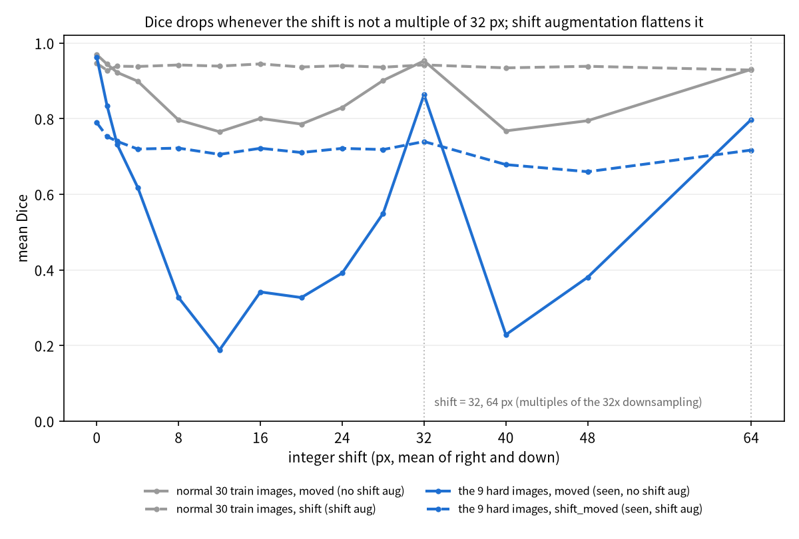

# BUSI：困難樣本與過擬合實驗

**結論**：U-KAN 在 BUSI 上有過擬合。訓練時加入隨機平移，測試集 Dice 從 0.782 升到 0.818（+0.036，p < 0.001），重訓一次結果相同。
但測試集中 Dice 接近 0 的 9 張困難影像，加了任何資料增強都只到 0.06–0.09，正則化救不回來。
數字全部來自 [`summary/`](summary/)（由 [`make_summary.py`](summary/make_summary.py) 從逐張結果算出）。

## 1. 我們改了什麼

**沒有增加任何樣本。** 訓練集 517 張、測試集 130 張，切分、模型架構、400 epoch、batch 8、Adam、256×256、評估方式都和 [U-KAN 官方](https://github.com/CUHK-AIM-Group/U-KAN) 相同；分析一律用最後一個 epoch（last）。
唯一的例外是 `moved`、`shift_moved`：把那 9 張測試影像搬進訓練集（訓練 526、測試 121）。

**改的是「訓練時即時的資料增強」**：每次讀取一張訓練影像時隨機變換，影像與遮罩同步；同一張影像每個 epoch 看到的版本都不同。測試時不做任何變換。

| 選項（`train.py`） | 作用 | 修改程式 |
|---|---|---|
| （官方） | 隨機旋轉 90° + 翻轉（各 p = 0.5） | 原版 |
| `--shift_aug 0.125` | 隨機平移 ±32 px（p = 0.5，邊緣補 0） | [patch_shiftaug.py](2026-11-14_shiftaug/patch_shiftaug.py) |
| `--scale_aug 0.1 --rotate_aug 15` | 再加縮放 ±10%、旋轉 ±15°（與平移同一步） | [patch_aug2.py](2026-11-15_aug/patch_aug2.py) |
| `--intensity_aug 0.2` | 再加亮度、對比 ±20% 與 gamma 80–120（各 p = 0.5） | [patch_aug2.py](2026-11-15_aug/patch_aug2.py) |
| `--drop_rate 0.1` / `0.3` | KAN 層 Dropout（原版建立了但 forward 沒有呼叫，接上） | patch_dropout.py（進行中） |
| `--wcases … --wfactor 3 --wnorm n` | Ψ8 加權 ×3 | [psi-weighted-busi](https://github.com/OwenWu930302/psi-weighted-busi) |

所有選項預設都等於原版：不給時，資料增強與網路輸出和原版逐位元相同（已驗證）。
訓練指令（官方指令 + 選項）：

```
python train.py --arch UKAN --dataset busi --input_w 256 --input_h 256 --name busi_UKAN_shift --data_dir ./inputs --shift_aug 0.125
```

## 2. 結果（測試集，last）

| 模型 | 訓練張數 | 資料增強 | 測試集 | 一般 115 | 低分 15 | 9 張 | 訓練集 | 差距 |
|---|---|---|---|---|---|---|---|---|
| base2（對照組） | 517 | 官方 | 0.782 | 0.860 | 0.180 | 0.003 | 0.966 | 0.184 |
| base3（重訓） | 517 | 官方 | 0.791 | 0.874 | 0.156 | 0.006 | 0.967 | 0.175 |
| psi8w3n | 517 | 官方 + Ψ8 加權 | 0.804 | 0.882 | 0.203 | 0.016 | 0.959 | 0.155 |
| **shift** | 517 | + 平移 | **0.818** | 0.895 | 0.233 | 0.089 | 0.939 | 0.120 |
| **shift_r2（重訓）** | 517 | + 平移 | **0.818** | 0.895 | 0.225 | 0.070 | 0.936 | 0.118 |
| ssr | 517 | + 平移、縮放、旋轉 | 0.822 | 0.902 | 0.209 | 0.063 | 0.929 | 0.107 |
| ssr_int | 517 | + 平移、縮放、旋轉、強度 | 0.818 | 0.894 | 0.234 | 0.070 | 0.926 | 0.108 |
| psi8w3n_shift | 517 | + 平移 + Ψ8 加權 | 0.810 | 0.892 | 0.186 | 0.022 | 0.928 | 0.118 |
| drop1、drop3、shift_drop1、shift_drop3 | 517 | Dropout 0.1 / 0.3 | 進行中 | | | | | |
| moved | 526 | 官方（9 張在訓練集） | 0.837* | 0.853* | | **0.962** | 0.968 | |
| shift_moved | 526 | + 平移（9 張在訓練集） | 0.872* | 0.895* | | **0.789** | 0.936 | |

- 低分 15 = baseline 測試集 Dice < 0.5；9 張 = 其中 Dice < 0.2 的 9 張；差距 = 訓練集 − 測試集。
- \* 搬移模型的測試集只剩 121 張，不能直接和上面比較。
- 完整數字：[models.csv](summary/models.csv)。

## 3. 成對比較（測試集 130 張，逐張配對 Wilcoxon）

| 比較 | 測試集 Δ | p | 9 張 Δ |
|---|---|---|---|
| base2 → base3（不加增強的重訓雜訊） | +0.009 | 0.70 | +0.003 |
| shift → shift_r2（加平移的重訓雜訊） | −0.001 | 0.46 | −0.019 |
| base2 → shift | **+0.037** | **0.0001** | +0.086 |
| base2 → shift_r2 | **+0.036** | **< 0.0001** | +0.067 |
| base3 → shift_r2 | **+0.027** | **0.0016** | +0.064 |
| shift → ssr（加縮放、旋轉） | +0.004 | 0.57 | −0.027 |
| ssr → ssr_int（加強度） | −0.004 | 0.68 | +0.008 |
| base2 → psi8w3n（Ψ8，無增強） | +0.022 | 0.027 | +0.013 |
| base3 → psi8w3n | +0.013 | 0.17 | +0.010 |
| shift → psi8w3n_shift（Ψ8，有平移） | −0.008 | 0.29 | −0.067 |
| shift_r2 → psi8w3n_shift | −0.008 | 0.095 | −0.048 |

完整（含一般、低分、訓練集各組）：[comparisons.csv](summary/comparisons.csv)。

## 4. 為什麼是平移：整數像素平移掃描



- 不加平移增強時，平移量不是 32 的倍數，Dice 就下降；32、64 px 時幾乎回到原本。U-KAN 把影像縮小 32 倍（5 次 ×2），而官方增強只有翻轉和旋轉 90°，所以每張影像只在同一個格子位置被看過。
- 9 張搬進訓練集後（moved），原圖 0.962，但平移 12 px 只剩 0.188；一般訓練影像同樣平移仍有 0.765。看過的 9 張是「死記」的。
- 加了平移增強後兩組曲線都變平；但 9 張即使在訓練集裡也只學到 0.789，`benign (116)` 仍是 0.000。
- 資料：[2026-11-14_perturb_sweep](2026-11-14_perturb_sweep/)、[2026-11-14_shiftaug/perturb_sweep](2026-11-14_shiftaug/perturb_sweep/)。

## 5. 那 9 張

每個模型在 9 張上的 Dice：[nine_cases.csv](summary/nine_cases.csv)。加了增強後只有少數幾張部分改善（最高 0.34），而且兩次訓練改善的不是同一批（shift：`benign (257)`、`benign (223)`；shift_r2：`malignant (105)`、`benign (236)`、`benign (257)`），屬於雜訊程度。

## 6. 資料夾

| 資料夾 | 內容 |
|---|---|
| [summary/](summary/) | 彙整：models.csv、comparisons.csv、nine_cases.csv、shift_sweep.png、make_summary.py |
| [2026-11-14_perturb/](2026-11-14_perturb/) | 擾動測試：moved 對 base2，9 張 + 30 張一般訓練影像，平移、縮放、旋轉、亮度、對比、gamma、模糊、雜訊 |
| [2026-11-14_perturb_sweep/](2026-11-14_perturb_sweep/) | 整數像素平移 1–64 px |
| [2026-11-14_shiftaug/](2026-11-14_shiftaug/) | 平移增強：shift、shift_moved（程式、逐張結果、訓練紀錄、擾動測試） |
| [2026-11-15_aug/](2026-11-15_aug/) | shift_r2、ssr、ssr_int、psi8w3n_shift |
| 2026-11-16_dropout/ | Dropout（進行中） |

對照組 base2、base3、moved、Ψ 專家的逐張結果在 [psi-weighted-busi/results/percase](https://github.com/OwenWu930302/psi-weighted-busi/tree/main/results/percase)。

重新產生彙整（兩個倉庫 clone 在同一層）：

```
python busi/summary/make_summary.py --busi_repo ../psi-weighted-busi --disc .
```
